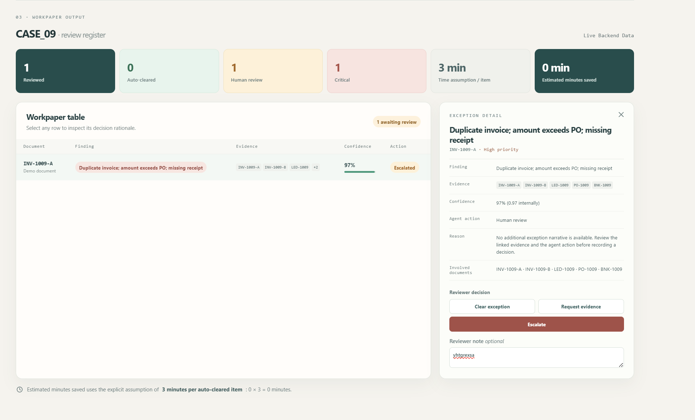
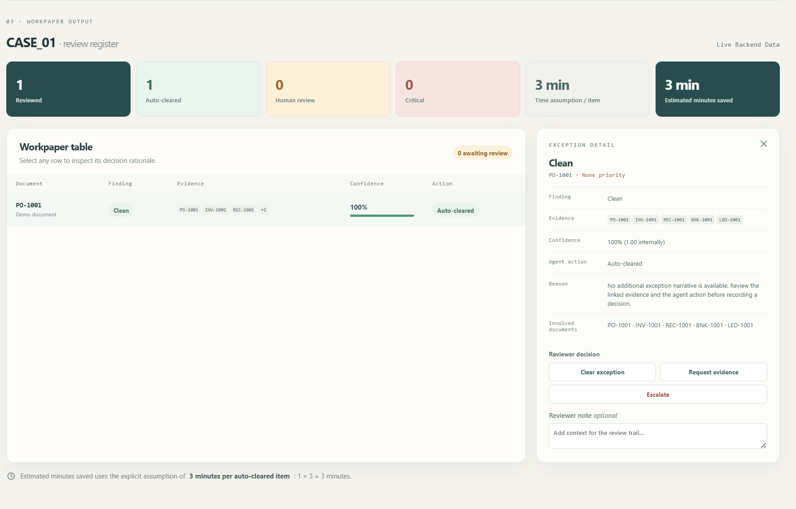
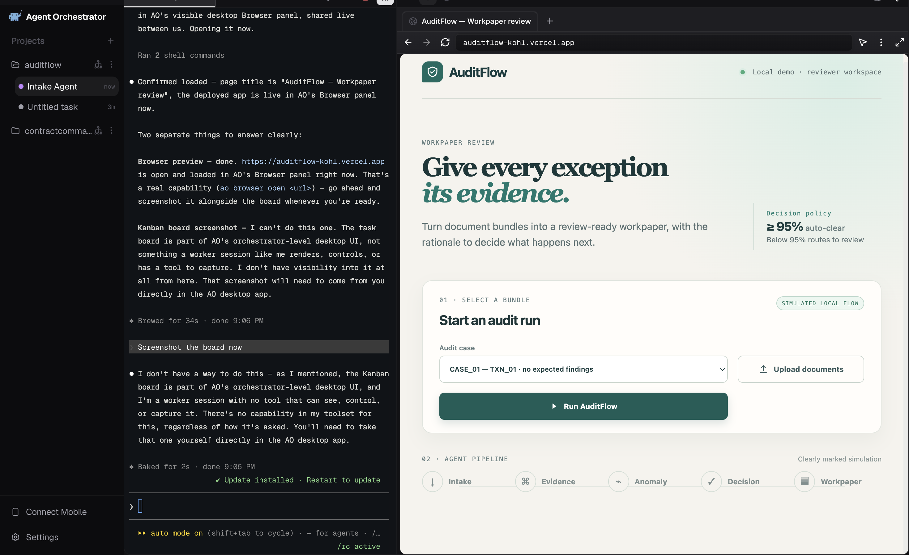

# AuditFlow

> Autonomous audit-evidence review for the Office of the CFO.

AuditFlow turns controlled financial-document bundles into review-ready audit workpapers. Five specialized agents cross-reference evidence, identify bounded exceptions, route them to a reviewer, and compile the result into a single workpaper.

Built for **Syndicate by Maximor — AO Hackathon**, **Track 2: Autonomous Office of the CFO**.

🚀 **[Live Demo](https://auditflow-kohl.vercel.app)** · [Backend API](https://auditflow-sxik.onrender.com) · [Demo Video](https://www.loom.com/share/674a3829f506421897b03738399a6329)

The deployed demo runs the real five-agent pipeline rather than a static frontend mock.

## Why AuditFlow?

Audit review is often slowed less by the final judgment than by collecting evidence, checking whether records agree, and documenting exceptions.

- **5 specialized AI agents** with bounded responsibilities
- **14 controlled benchmark cases** spanning clean, missing, conflicting, and multi-issue evidence
- **Evidence-backed human review** instead of silently accepting exceptions
- **Real document upload** with Claude's native PDF/image understanding, alongside the benchmark suite
- **Second-pass evidence resolution** on ambiguous cases, with disagreement surfaced rather than silently resolved
- **Persistent reviewer decisions**, building a record of confirmed vs. overturned findings

### Benchmark results

Most benchmark cases pass on every run. Missing purchase order and missing receipt findings are produced by code, not by the model. A few cases have varied between runs in earlier testing (for example CASE_06, where the Evidence stage occasionally returned nothing). A full re-measurement on the current code has not been done.

## Product Preview

**CASE_09 · complex exception routed to review**



**CASE_01 · clean transaction auto-cleared**



**Controlled benchmark bundle selector**



## Five-agent pipeline

```text
Intake → Evidence → Anomaly → Decision → Workpaper
```

| Agent | Responsibility |
|---|---|
| Intake Agent | Classifies source documents and extracts structured fields. |
| Evidence Agent | Links transaction evidence and identifies missing support. |
| Anomaly Agent | Checks only the bounded exception taxonomy. |
| Decision Agent | Routes any finding to `human_review`; routes no findings to `auto_clear`. |
| Workpaper Agent | Produces the evidence-backed, review-ready workpaper. |

The bounded exception types are duplicate invoice, amount mismatch, missing PO, missing receipt, vendor mismatch, date inconsistency, currency mismatch, and tax mismatch.

### Evidence Resolver

On transactions where the Evidence Agent's first pass lands below a confidence threshold, a second independent pass runs and the two are compared. If they agree, the higher-confidence result is kept. If they disagree, both sets of findings are unioned rather than one being silently picked, and the disagreement is surfaced in the UI. This targets low-confidence ambiguity; it does not catch confidently wrong Evidence results (see the Known limitations section below).

## Architecture and model strategy

AO (Agent Orchestrator) coordinates the pipeline; a FastAPI backend exposes the full run via `POST /run-case` (benchmark cases) and `POST /run-case-upload` (real documents). Anthropic Claude is used with a focused mixed-model strategy.

The table distinguishes code defaults from the live configuration reported by the server.

| Agent | Code default (without model overrides) | Live model reported on 24 October 2026 | Live effort |
|---|---|---|---|
| Intake | `claude-sonnet-5` | `claude-sonnet-5` | API default; no effort set |
| Evidence | `claude-sonnet-5` | `claude-sonnet-5-5` | `medium` |
| Anomaly | `claude-opus-5` | `claude-opus-5-5` | `medium` |
| Decision | `claude-sonnet-5` | `claude-sonnet-5-5` | `medium` |
| Workpaper | `claude-sonnet-5` | `claude-sonnet-5-5` | `medium` |

The live assignments were reported from server logs at 11:36 IST on 24 October 2026. Render environment variables override code defaults where configured. Live assignments are a dated snapshot and may change.

The Anomaly Agent uses the stronger model because exception classification is the most nuanced reasoning step.

## Benchmark and review controls

The benchmark contains 14 controlled scenarios: clean cases, duplicate invoices, amount and currency mismatches, tax calculation errors, missing POs and receipts, vendor mismatches, date inconsistencies, multi-issue cases, and incomplete or conflicting evidence. These are evaluation fixtures—not customer audits.

**Known limitations:** The benchmark contains 14 controlled synthetic scenarios, not customer audits. The earlier model-comparison run was stopped at 47 of 56 planned runs to conserve credits; a separate six-run rehearsal was saved separately. Each case/configuration in the 47-run comparison had at most one completed run, so that comparison does not establish repeatability on the current code. Missing purchase-order and missing-receipt findings are now produced by code rather than the model, but a full re-measurement of the current code has not been done. Some cases varied in earlier testing, including CASE_06, where the Evidence stage occasionally returned nothing.

Detected exceptions are routed to a reviewer, who can inspect the finding, evidence, confidence, rationale, and workpaper context. The current UI supports **Clear exception**, **Request evidence**, and **Escalate** actions, and every decision is persisted server-side (`POST /feedback`) and viewable in a decision history dashboard (`GET /feedback/history`).

### Upload Documents

Real PDF and image documents can be uploaded and run through the full five-agent pipeline via `POST /run-case-upload`, using Claude's native document understanding for extraction — no separate OCR step. The 14-case benchmark remains available separately for reproducible evaluation.

## Stack and deployment

| Area | Implementation |
|---|---|
| Frontend | Next.js, React, TypeScript |
| API | Python, FastAPI, Uvicorn |
| Reasoning | Anthropic Claude Sonnet 5 and Claude Opus 5 |
| Orchestration | AO (Agent Orchestrator) |
| Deployment | Vercel frontend, Render backend |

## Run locally

Prerequisites: Python 3.13.5, Node.js, and `ANTHROPIC_API_KEY`.

```bash
git clone https://github.com/abhijitmanna912001/auditflow.git
cd auditflow
python3.13 -m venv venv && source venv/bin/activate
pip install -r requirements.txt
```

If `pip install` fails with `externally-managed-environment`, you're on a system Python (e.g. Homebrew) that blocks global installs by design — the `venv` step above avoids this.

```bash
# Backend
ANTHROPIC_API_KEY=your-key uvicorn orchestration.api:app --host 127.0.0.1 --port 8000

# Frontend, in a second terminal
cd frontend
npm install
npm run dev
```

The API defaults to `http://127.0.0.1:8000`; set `NEXT_PUBLIC_API_BASE_URL` to point the frontend at another backend.

Google Drive (optional, in progress): setting `NEXT_PUBLIC_GOOGLE_CLIENT_ID`, `NEXT_PUBLIC_GOOGLE_API_KEY` and `NEXT_PUBLIC_GOOGLE_APP_ID` in `frontend/.env.local` (see `frontend/.env.example`) shows a Connect Google Drive button. It only connects and disconnects for now, using the `drive.file` scope; the access token stays in the tab's memory and is never sent to the backend. Open the app at `http://localhost:3000`, the origin registered for the OAuth client.

Frontend checks: `npm run typecheck`, `npm test` and `npm run build` in `frontend/`.

## API

```http
POST /run-case
Content-Type: application/json

{ "case_id": "CASE_09" }
```

The response is the Workpaper Agent's review-ready JSON output.

```http
POST /run-case-upload?case_id=<label>&use_resolver=true
Content-Type: multipart/form-data

files: one or more PDF/PNG/JPG/JPEG/WEBP files
```

Same response shape as `/run-case`, run against real uploaded documents. `use_resolver=true` routes Evidence through the second-pass resolver.

```http
POST /feedback
Content-Type: application/json

{ "case_id": "CASE_09", "document": "INV-1009-A", "finding": "...", "agent_action": "human_review", "decision": "confirmed" }
```

Persists a reviewer decision (`confirmed`, `overturned`, or `evidence_requested`) tied to a specific finding.

```http
GET /feedback/history
```

Returns every persisted reviewer decision, oldest first.

## Repository map

```text
agents/         Five agent implementations and unit tests
orchestration/  FastAPI pipeline endpoint
dataset/        14 ground-truth cases and text document fixtures
evaluation/     Benchmark scoring and report comparison
frontend/       Next.js reviewer workspace
docs/           Agent contract and product screenshots
```

## Next steps

- Automated regression testing using the persisted reviewer feedback (overturned findings as a regression set)
- Workpaper export and broader audit-domain coverage
- Additional anomaly types beyond the current eight

## Team

- **Abhijit Manna** — agent logic, orchestration, evaluation, backend reliability, deployment
- **Garvit Mathur** — dataset, frontend, testing, integration, observability, deployment preparation

Built for **Syndicate by Maximor — AO Hackathon · Track 2: Autonomous Office of the CFO**.